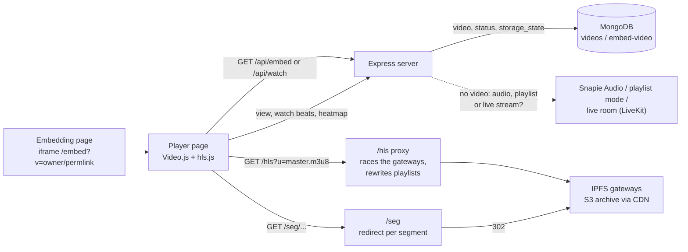

<p align="center">
  
</p>

<h1 align="center">Snapie Video Player</h1>

<p align="center">
  <strong>The HTML5 video player of <a href="https://snapie.io">Snapie</a>, by Mantequilla Soft.</strong><br>
  It powers 3Speak's player at <a href="https://play.3speak.tv">play.3speak.tv</a>: one iframe URL
  for every 3Speak video, Short, playlist and live stream.
</p>

<p align="center">
  =20" src="https://img.shields.io/badge/node-%3E%3D20-4a9eff?labelColor=1a2332">
  
  
  
  
  <a href="https://github.com/Mantequilla-Soft/snapievideoplayer/actions/workflows/ci.yml"></a>
  
</p>

<p align="center">
  Part of <a href="https://snapie.io">Snapie</a>, alongside
  <a href="https://github.com/Mantequilla-Soft/snapieaudio">Snapie Audio</a>.
</p>

---

Snapie Video Player (Snapie Player for short) is the player behind every 3Speak embed.
A Hive frontend, a mobile app or a partner site drops in one iframe with an
`owner/permlink`, and the player works out the rest: whether that is a video, a Short,
a playlist, an audio post or a live stream, where its files live right now, and what
the viewer should see if it is still encoding, failed, or was deleted.

The hard part it solves is availability. 3Speak videos sit on IPFS gateways and, once
archived, in an S3 bucket behind a CDN. Any of those can be slow or missing a file on a
given day. The player's small Node/Express server proxies the HLS manifests, races the
gateways, and redirects each segment to a source that can serve it, so an embed keeps
playing instead of spinning.

On top of plain playback it adds what 3Speak needs: a scrub preview thumbnail on the
seek bar, a "most replayed" heatmap, creator chapters and link cards, captions, a
`postMessage` API for the embedding page, view counting and server-measured watch time,
and the sponsor breaks of the 3Speak ad system.

Try every option on the live demo: **[play.3speak.tv/embed-demo.html](https://play.3speak.tv/embed-demo.html)**.

## Contents

- [Embed it](#embed-it): [URL forms](#url-forms) · [URL parameters](#url-parameters) · [layouts](#layouts) · [postMessage API](#postmessage-api) · [partner viewer tokens](#partner-viewer-tokens)
- [How it works](#how-it-works)
- [Quick start](#quick-start)
- [Configuration](#configuration)
- [Reference](#reference): [pages](#pages) · [HTTP API](#http-api) · [video status](#video-status)
- [Development and tests](#development-and-tests)
- [Deployment](#deployment)
- [Repository layout](#repository-layout)
- [Further docs](#further-docs)
- [Security notes](#security-notes)
- [Contributing](#contributing)

## Embed it

```html
<iframe
  src="https://play.3speak.tv/embed?v=badadib/<permlink>&mode=iframe"
  style="width:100%;aspect-ratio:16/9;border:0"
  allowfullscreen
  allow="autoplay; encrypted-media; picture-in-picture"
  title="Snapie Video Player">
</iframe>
```

That is the whole integration for most sites. [EMBEDDING.md](EMBEDDING.md) has responsive
containers, React, iOS, Android, React Native and Flutter examples, and
[docs/3SPEAK_EMBED_INTEGRATION_INSTRUCTIONS_FOR_AGENTS.md](docs/3SPEAK_EMBED_INTEGRATION_INSTRUCTIONS_FOR_AGENTS.md)
is a compact spec for turning 3Speak links into embeds automatically.

### URL forms

| URL | Plays |
|---|---|
| `https://play.3speak.tv/embed?v=<owner>/<permlink>` | A current upload (the `embed-video` collection). Either the asset permlink or its Hive post permlink works. |
| `https://play.3speak.tv/watch?v=<owner>/<permlink>` | A legacy video (the `videos` collection), falling back to the `embed-video` collection, so it plays current uploads too. |
| `https://play.3speak.tv/watch?v=<owner>/<playlist id>` | A public playlist. Videos (and any audio in it) play one after another in the same player, with previous, next and a list. An audio-only playlist opens the Snapie Audio player instead. |
| `https://play.3speak.tv/watch?v=<owner>/<audio permlink>` | An audio post shared as a video link: the page hands over to the Snapie Audio player. |
| `https://play.3speak.tv/play?v=<owner>/<permlink>` | Same as `/embed`, but never counts a view (watch time is still measured). Add `type=legacy` for a legacy video. |
| `https://play.3speak.tv/embed?live=<room>` | A running OpenPods live stream over WebRTC (LiveKit), with read-only chat. |

A `v` that names no video is also tried as a live stream: the server probes the live
streaming servers for a room matching it, so a stream post embeds with the same URL as
any video. A stream that has ended says so instead of failing silently.

The audio, playlist and live fallbacks work on both `/watch` and `/embed`, because many
Hive frontends only turn `play.3speak.tv/watch?v=` links into embeds and keep nothing
but `v`.

### URL parameters

Flags accept `1`, `true` or `yes` to turn on and `0`, `false` or `no` to turn off.

| Parameter | Default | Effect |
|---|---|---|
| `v` | required | `owner/permlink` (or `owner/<playlist id>`) |
| `mode=iframe` | off | Minimal embed chrome: no page header or info. Recommended inside iframes. |
| `layout` | `desktop` | `desktop` (16:9, letterboxed), `mobile` (tall 3:4 box for apps), `square` (1:1). See [layouts](#layouts). |
| `autoplay=1` | off | Start playing on load, falling back to muted when the browser blocks sound. |
| `mute=1` | off | Start muted. The parent can unmute with the `unmute` command. |
| `loop=1` | off | Restart at the end (no `3speak-ended` event). |
| `controls=0` | on | Hide the player controls. |
| `captions=0` | on | Do not show captions, even when the video has them. |
| `preview=0` | on | Turn off the scrub preview thumbnail above the seek bar. |
| `heatmap=0` | on | Turn off the "most replayed" heatmap above the seek bar (it only shows once enough viewers watched). |
| `tvmode=1` | off | TV remote mode: Enter toggles fullscreen and the Video.js hotkeys are off. |
| `noscroll=1` | off | Hide scrollbars on the player page. |
| `noview=1` | off | Do not count a view (what `/play` does). |
| `type=legacy` | `embed` | On `/play` only: look the video up as a legacy video. |
| `live` (or `room`) | none | Play a live OpenPods room by name. |
| `api`, `lk` | `https://live.3speak.tv`, `wss://live.3speak.tv` | Live only: override the streaming API and the LiveKit WebSocket URL. |
| `viewer` | none | The Hive account watching, so a Pro subscriber is recognised and not shown ads. Not used for rewards. |
| `vt` | none | A signed partner viewer token (see [below](#partner-viewer-tokens)). |
| `private=1` | off | Mark the watch session private. |
| `strict=1` | off | Operator check: play only from the source the server assigned (the S3 copy of an archived video), with no fallback and no sponsor break. Not for viewers. |
| `debug=1` | off | Verbose logging to the browser console. |

### Layouts

| `layout` | Box | Good for |
|---|---|---|
| `desktop` (default) | 16:9 | Blog posts and web pages. Vertical videos get side bars, like YouTube. |
| `mobile` | 3:4 | iOS, Android, React Native and Flutter WebViews: one box for every orientation, no scrollbars. |
| `square` | 1:1 | Grids and thumbnails. |

To size the iframe to the video instead, listen for `3speak-player-ready` (below), which
reports the real width, height and orientation once the stream is loaded.

### postMessage API

**Player to parent.** Sent only when the player is inside an iframe.

| `type` | Payload | When |
|---|---|---|
| `3speak-player-ready` | `isVertical`, `width`, `height`, `aspectRatio`, `orientation` (`vertical`, `horizontal` or `square`), `ad` | The picture is known, and again when its shape changes |
| `3speak-play` / `3speak-pause` / `3speak-ended` | none | Playback state changes |
| `3speak-timeupdate` | `currentTime`, `duration`, `paused`, `muted`, `volume` | About four times a second |
| `3speak-durationchange` | `duration` | Duration becomes known or changes |
| `3speak-volumechange` | `muted`, `volume` | Volume or mute changes |
| `3speak-state` | `currentTime`, `duration`, `paused`, `muted`, `intendedMuted`, `volume`, `ended` | Reply to `getState` |
| `3speak-quality-levels` | `levels` (`index`, `width`, `height`, `bitrate`, `label`, `enabled`), `currentIndex` (`-1` = auto) | Reply to `getQualityLevels` |
| `3speak-quality-changed` | `level` | After `setQualityLevel` |
| `3speak-caption-languages` | `languages`, `selectedLang` | Reply to `getCaptionLanguages` |
| `3speak-source` | `kind` (`playlist` or `segment`), `url`, `proxied`, `confirmed`, `ok`, `status`, `strict` | Every HLS playlist and segment, naming the gateway or bucket that really served it (not on native iOS HLS) |

```js
window.addEventListener('message', (event) => {
  if (event.data?.type !== '3speak-player-ready') return;
  const iframe = [...document.querySelectorAll('iframe')]
    .find((f) => f.contentWindow === event.source);
  if (iframe) iframe.style.aspectRatio = String(event.data.aspectRatio);
});
```

**Parent to player.** Send `{ type: '<command>', ... }` (the player also reads `action`
or `command` as the key). Both the camelCase and the kebab-case spelling work.

| Command | Payload | Does |
|---|---|---|
| `play` / `playVideo`, `pause` / `pauseVideo`, `togglePlay` / `toggle-play` | none | Playback |
| `mute`, `unmute`, `toggleMute` | none | Sound |
| `setVolume` / `set-volume` | `volume` (0 to 1) | Sets the volume, unmuting when above 0 |
| `volumeUp` / `volume-up`, `volumeDown` / `volume-down` | `step` (default 0.1) | Steps the volume |
| `seek` | `time` (seconds) | Seeks to a time |
| `seekForward`, `seekBackward` | `seconds` (default 10) | Seeks relative |
| `toggleFullscreen`, `enterFullscreen`, `exitFullscreen` (or kebab-case) | none | Fullscreen |
| `fullscreen-entered`, `fullscreen-exited` | none | Tells the player the parent put its iframe in CSS fullscreen (or left it), so it fills the frame |
| `lock-orientation`, `unlock-orientation` | none | Locks the screen to the video's orientation on mobile, and releases it |
| `togglePip` / `toggle-pip` | none | Picture in picture |
| `getState`, `getQualityLevels`, `getCaptionLanguages` | none | Answered with the events above |
| `setQualityLevel` / `set-quality-level` | `level` (index, or `-1` / `'auto'`) | Pins a rendition or returns to auto |
| `setCaptions` / `set-captions` | `lang` (or `null` for off) | Picks a caption language |

```js
const player = document.querySelector('iframe').contentWindow;
player.postMessage({ type: 'seek', time: 30 }, '*');
player.postMessage({ type: 'unmute' }, '*');
```

### Partner viewer tokens

An app can let its own signed-in viewers earn a share of 3Speak ad revenue from embeds.
Its backend signs a short-lived token (HMAC-SHA256, bound to one viewer and one video,
900 seconds at most) with an app secret issued by 3Speak, and passes it as `vt`:

```
https://play.3speak.tv/embed?v=<owner>/<permlink>&mode=iframe&vt=<token>
```

Without `vt`, playback works exactly the same, anonymously. The full flow (opt-in,
minting, what has to be true for a watch to earn) is in
[docs/partner-integration.md](docs/partner-integration.md), and
[scripts/mint-viewer-token.cjs](scripts/mint-viewer-token.cjs) is a runnable reference
of the minting step. The secret belongs on the partner's server only, never in a page,
a URL or a repo.

## How it works



1. **Resolve.** The page reads `v` and asks `/api/embed` (or `/api/watch`). The server
   finds the video in MongoDB, then decides what to serve: the real HLS manifest, or a
   short placeholder clip when it is still processing, failed, deleted, or an expired
   24-hour Story. When there is no video, it says whether `v` is an audio post, a
   playlist, or (via `/api/stream`) a live stream, and the page switches to that.
2. **Pick a source.** Each video plays from where it lives, chosen from its
   `storage_state`: the IPFS hot node first, or the S3 archive first for videos that were
   moved off IPFS. The manifest URL the player gets points at the server's `/hls` proxy.
3. **Play.** `/hls` fetches the master playlist, racing the gateways so a video that left
   the hot zone still plays and one that is really gone fails fast. It also strips a
   wrong audio-only `CODECS` line written by the legacy encoder. Variant playlists come
   back through `/hls` with every segment pointing at `/seg`, which redirects that one
   segment to a gateway that can serve it right now. Segment bytes go straight from the
   gateway to the browser.
4. **Measure.** The first play counts a view (`/api/view`). Watch time is measured by the
   server from heartbeats (`/api/watch/start`, `/api/watch/beat`), which also feed the
   heatmap. When the 3Speak ad system has a sponsor break for this playback, the player
   swaps in its stitched manifest and maps the timeline back to content time, so ad
   seconds never count as watch time.

## Quick start

You need Node.js 20 or newer and a MongoDB with 3Speak's video collections.

```bash
git clone https://github.com/Mantequilla-Soft/snapievideoplayer.git
cd snapievideoplayer
npm install
cp .env.example .env     # then fill in MONGODB_URI, the gateway and the placeholder CIDs
npm start                # production build, then the server on http://localhost:3005
```

Then open `http://localhost:3005/embed?v=<owner>/<permlink>`, or the local demo page at
`http://localhost:3005/embed-demo-local.html`.

| Script | Does |
|---|---|
| `npm start` | `webpack --mode production`, then `node server.js` |
| `npm run dev` | Development build, then `node server.js` |
| `npm run server` | Start the server on the existing `dist/` build |
| `npm run build` / `npm run build:dev` | Build the player into `dist/` only |

## Configuration

All configuration is read from the environment (`.env` via dotenv). Never commit `.env`.

**Core**

| Variable | Purpose | Default |
|---|---|---|
| `PORT` | HTTP port | `3005` |
| `NODE_ENV` | `development` or `production` | none |
| `PUBLIC_BASE_URL` | Public origin of this player, used in proxied manifest and poster URLs. Set it in every deployment (e.g. `https://play.3speak.tv`). | a preview host |
| `MONGODB_URI` | MongoDB connection string | required |
| `MONGODB_DATABASE` | Database name | required |
| `MONGODB_COLLECTION_LEGACY` | Legacy videos collection | required (`videos`) |
| `MONGODB_COLLECTION_NEW` | Current uploads collection | required (`embed-video`) |
| `MONGODB_COLLECTION_VIEWS` | View counter rows | `views` |
| `MONGODB_COLLECTION_AUDIO` | Audio posts, for the audio hand-off | `embed-audio` |
| `HIVE_API` | Hive RPC node for post lookups (timelines, stream posts, playlists) | `https://api.hive.blog` |
| `AUDIO_EMBED_BASE` | The Snapie Audio player that audio and audio playlists hand off to | `https://audio.3speak.tv` |

**Sources and placeholders**

| Variable | Purpose | Default |
|---|---|---|
| `IPFS_GATEWAY` | IPFS gateway base URL (e.g. `https://ipfs.3speak.tv/ipfs`) | required |
| `IPFS_GATEWAY_FALLBACK` | Second gateway, also allowed for the proxy | none |
| `S3_BUCKET` | The S3 bucket archived videos play from. Unset: everything plays from IPFS and `storage_state` is ignored. | none |
| `S3_CDN_HOST` | CDN pull zone in front of that bucket | `buttercloud.b-cdn.net` |
| `HLS_FETCH_TIMEOUT_MS` | Per-gateway timeout in `/hls` (at least 1000) | `7500` |
| `S3_FETCH_TIMEOUT_MS` | Timeout for one S3 source before the next (at least 200) | `3000` |
| `IPFS_PROXY_HEADER_TIMEOUT_MS` | Header timeout in `/ipfs-proxy` (at least 1000) | `15000` |
| `PLACEHOLDER_PROCESSING_CID` | `ipfs://` clip shown while a video uploads or encodes | required |
| `PLACEHOLDER_FAILED_CID` | Clip shown when encoding failed | required |
| `PLACEHOLDER_DELETED_CID` | Clip shown for a deleted video | required |
| `PLACEHOLDER_STORY_EXPIRED_CID` | Overrides the bundled clip for an expired 24-hour Story | bundled in `assets/` |
| `DEFAULT_THUMBNAIL_CID` | Poster when a video has no thumbnail | none |

**Live streams**

| Variable | Purpose | Default |
|---|---|---|
| `STREAM_ENDPOINTS` | Comma-separated `apiBase\|livekitWsUrl` pairs probed when `v` is not a video. `https://live.3speak.tv` is always probed. | built-in list |
| `LIVE_ROOM_API_URLS` | Streaming servers a live watch session is checked against | `https://live.3speak.tv` |

**Watch tracking and viewer rewards**

| Variable | Purpose | Default |
|---|---|---|
| `WATCH_LOG_COLLECTION` | Measured watch durations | `view-durations` |
| `WATCH_SESSION_COLLECTION` | Open watch sessions | `view-sessions` |
| `WATCH_HEATMAP_COLLECTION` | Heatmap buckets | `view-heatmaps` |
| `WATCH_BEAT_SECONDS` | Heartbeat interval | `5` |
| `WATCH_BUCKET_COUNT` | Heatmap buckets per video (at least 10) | `100` |
| `VIEW_IP_HASH_SECRET` | Key for the per-video IP hash on view rows. Unset: no hash is stored. | none |
| `IP_HASH_SECRET` | Key for the viewer IP hashes on watch rows. Unset: none are stored. | none |
| `AD_PARTNER_KEYS` | `appId:secret` pairs for partner viewer tokens (secrets shorter than 24 characters are ignored) | none |
| `AD_VIEWER_TOKEN_REQUIRED` | `true`: a viewer can only be named by a signed token | `false` |
| `AD_VIEWER_TOKEN_MAX_TTL_S` | Longest token lifetime accepted (at least 60) | `900` |
| `AD_VIEWER_REWARD_SOURCES` | Sources trusted to name their viewer | `3speak` |
| `AD_VIEWER_MIN_PCT` | Share of a video a viewer must watch to qualify | `75` |
| `AD_VIEWER_MAX_SECONDS` | Credited seconds per viewer and video | `1200` |
| `AD_STREAM_VIEWER_MIN_SECONDS` / `AD_STREAM_VIEWER_MAX_SECONDS` | Live streams: seconds on screen to qualify, and credited seconds per stream | `300` / `AD_VIEWER_MAX_SECONDS` |
| `AD_VIEWER_PREFS_COLLECTION` / `AD_VIEWER_WATCH_COLLECTION` | Viewer opt-ins and the reward ledger | `ad_viewer_prefs` / `ad_viewer_watch` |
| `INCUBATION_WATCH_COLLECTION` / `INCUBATION_MAX_SECONDS` | Watch time of new users who have no Hive account yet | `incubation_watch` / `AD_VIEWER_MAX_SECONDS` |

## Reference

### Pages

| Route | Serves |
|---|---|
| `GET /` | Landing page |
| `GET /watch`, `/embed`, `/play` | The player page (see [URL forms](#url-forms)) |
| `GET /embed-demo.html` | Interactive embed demo with code samples |
| `GET /embed-demo-local.html` | The demo against a local server |
| `GET /debug-mobile.html` | Mobile debugging helper |
| `GET /assets/*` | Logos and the bundled Story-expired clip |

### HTTP API

CORS is open on every route. `v` is always `owner/permlink`.

| Endpoint | Does |
|---|---|
| `GET /api/watch?v=` | Legacy video (falling back to current uploads): status, manifest URLs with fallbacks, thumbnail, views, timeline. A miss answers 404 with `audioEmbed` or `videoPlaylist` when `v` is one of those. |
| `GET /api/embed?v=` | The same for current uploads, including `short` and Story fields. |
| `GET /api/watch?v=&info=true`, `GET /api/embed?v=&info=true` | Minimal JSON for mobile apps (CID, CDN manifest, thumbnail, views), see [docs/MOBILE_API_SPEC.md](docs/MOBILE_API_SPEC.md). |
| `GET /api/playlist?v=owner/<playlist id>` | `{ id, owner, name, items: [{ v, title, thumbnail, duration }] }` for a public playlist; items that cannot play are left out. |
| `GET /api/timeline?post=author/permlink` | The creator timeline (chapters and link cards) of a Hive post. |
| `GET /api/stream?v=` | Resolves a `v` with no video to a live room: `{ found, live, roomName, api, lk, host, title, thumbnail }`, or `{ found: false, endedStream: true }`. |
| `GET /api/heatmap?v=` | Aggregate watch coverage buckets for the heatmap. |
| `POST /api/view` | `{ owner, permlink, type: 'legacy' \| 'embed' }`. Counts a view for a playable video (never for a placeholder). |
| `POST /api/duration` | `{ owner, permlink, duration }`. Heals a missing or wrong stored duration. |
| `POST /api/watch/start` | Opens a server-measured watch session (`owner`, `permlink`, `type`, `duration`, `position`, optional `viewerToken`, `private`). |
| `POST /api/watch/beat` | Heartbeat for that session. Does not touch the view counter. |
| `GET /hls?u=<master .m3u8 URL>` (also `/hls/manifest.m3u8`) | Manifest proxy: gateway race, codec fix, playlist rewrite. Fetches only from its own gateways and bucket. |
| `GET /seg/<file>?u=<segment URL>` | Redirects one segment to a gateway that can serve it. Not an open redirector. |
| `GET /ipfs-proxy?u=` | Streams an object from a gateway that lacks CORS, with retry on another gateway. |

### Video status

| Stored status | The player shows |
|---|---|
| `published`, `scheduled`, `publish_later`, `publish_manual` | The video |
| `uploaded`, `encoding_ipfs`, `ipfs_pinning` | The processing placeholder |
| `encoding_failed`, `failed` | The failed placeholder |
| `deleted`, `delete`, `self_deleted` | The deleted placeholder |
| A Story past `story_expires_at` | The Story-expired clip and poster |

## Development and tests

```bash
npm run lint            # ESLint
npm test                # legacy scripts/test-*.mjs, then the Vitest suite
npm run test:unit       # Vitest only
npm run test:coverage   # Vitest with the coverage report and floor
npm run test:legacy     # scripts/test-*.mjs only
npm run build           # production webpack build
```

`.github/workflows/ci.yml` runs lint, both test sets (with the coverage floor from
`vitest.config.mjs`) and the build on every pull request into `master`. The tests need no
secrets and no network: Mongo is an in-memory `mongod`, and `fetch` throws unless a test
stubs it. See [tests/README.md](tests/README.md) for the harness and what a pull request
is expected to bring.

`./safety-check.sh` checks locally that `.env` is gitignored and that no MongoDB
credentials are committed.

## Deployment

Merging to `master` deploys through `.github/workflows/deploy.yml` (build, prune dev
dependencies, restart the service). The one-time server setup, the production
environment, how to verify a deploy and how to roll back are in
[DEPLOYMENT.md](DEPLOYMENT.md).

## Repository layout

```
.
├── server.js              # Express app: pages, /api/*, /hls, /seg, /ipfs-proxy
├── db.js                  # MongoDB connection and video and view queries
├── hlsGateways.js         # which gateway or bucket serves each HLS segment
├── watchTracking.js       # watch sessions, heartbeats, heatmap, viewer tokens and rewards
├── videoPlaylist.js       # public playlists for playlist mode
├── audioEmbed.js          # hands audio posts and audio playlists to Snapie Audio
├── timeline.js            # creator chapters and link cards from the Hive post
├── videoStatus.js         # the shared video status vocabulary
├── watch-durations.cjs    # CLI to inspect recorded watch durations
├── src/                   # the player (bundled by webpack into dist/)
│   ├── main.js            # boot, URL params, playback, postMessage API, view and watch tracking
│   ├── index.html         # player page template
│   ├── styles.css         # player styling
│   ├── scrubPreview.js    # seek bar thumbnail preview
│   ├── heatmapBar.js      # "most replayed" heatmap
│   ├── timelineUI.js      # chapter marks and link cards
│   ├── captionUI.js       # caption menu
│   ├── subtitleManager.js # caption loading and language choice
│   ├── srtParser.js       # SRT parsing
│   ├── adBreak.js         # client half of server-side sponsor breaks
│   ├── playlist.js        # playlist mode UI
│   ├── playlistAudio.js   # audio items inside a video playlist
│   ├── live.js            # live OpenPods viewer (LiveKit)
│   ├── livePreroll.js     # pre-roll before a live stream
│   ├── liveChat.js        # read-only live chat
│   ├── sourceReport.js    # 3speak-source messages to the parent
│   └── tipButton.js       # tip button in the control bar
├── assets/                # logos, Story-expired clip and poster
├── embed-demo.html        # live embed demo (play.3speak.tv/embed-demo.html)
├── embed-demo-local.html  # the demo against localhost
├── landing.html           # landing page at /
├── debug-mobile.html      # mobile debug helper
├── scripts/               # legacy test scripts, data migrations, mint-viewer-token.cjs
├── tests/                 # Vitest suites (server, player, harness)
├── docs/                  # integration and design notes
├── .github/workflows/     # ci.yml (pull requests), deploy.yml (merges to master)
├── webpack.config.js      # player build
├── vitest.config.mjs      # test projects and coverage floor
└── eslint.config.js       # lint config
```

## Further docs

- [EMBEDDING.md](EMBEDDING.md): embedding guide with app and framework examples
- [docs/partner-integration.md](docs/partner-integration.md): viewer opt-in, tokens and rewards for partner apps
- [docs/3SPEAK_EMBED_INTEGRATION_INSTRUCTIONS_FOR_AGENTS.md](docs/3SPEAK_EMBED_INTEGRATION_INSTRUCTIONS_FOR_AGENTS.md): link detection and embed rules in one spec
- [docs/MOBILE_API_SPEC.md](docs/MOBILE_API_SPEC.md): the `info=true` endpoints
- [docs/EMBED_HIVE_PERMLINK_LOOKUP.md](docs/EMBED_HIVE_PERMLINK_LOOKUP.md): resolving a Hive post permlink to its upload
- [docs/CODEC_COMPATIBILITY_ISSUE.md](docs/CODEC_COMPATIBILITY_ISSUE.md) and [docs/CODEC_ERROR_HANDLING.md](docs/CODEC_ERROR_HANDLING.md): the legacy codec bug and how the player handles it
- [docs/FRONTEND_VERTICAL_VIDEO_RACE_CONDITION.md](docs/FRONTEND_VERTICAL_VIDEO_RACE_CONDITION.md): sizing vertical videos in a host page
- [docs/JW_PLAYER_REFERENCE.md](docs/JW_PLAYER_REFERENCE.md): notes on the aspect ratio approach
- [DEPLOYMENT.md](DEPLOYMENT.md): deploying and rolling back

## Security notes

- **The proxies only reach known hosts.** `/hls`, `/seg` and `/ipfs-proxy` take an
  `https` URL under an `/ipfs/` path and fetch or redirect only to the player's own
  gateways and the configured bucket. A URL naming any other host is served from those
  gateways by its CID path, and that host is never contacted. S3 URLs are built from the
  CID path, never taken from the request. They are not open proxies or open redirectors.
- **Viewer names are never taken in the clear for rewards.** An embed URL is
  copy-pasteable, so a watch earns for a named viewer only with a partner token signed by
  a secret 3Speak issued (or from a trusted first-party source), bound to one video and
  valid for minutes. `?viewer=` only affects which ads are shown. The opt-in is re-checked
  on the server for every watch.
- **IP addresses are stored only as keyed hashes**, and only when the hash secrets are
  set. Treat those secrets like credentials: with one, IPv4 hashes can be brute-forced.
- **Secrets stay in `.env`.** `.env` is gitignored, `.env.example` holds names only, and
  the tests run without any real secret.

## Contributing

Issues and pull requests are welcome. Run `npm run lint`, `npm test` and `npm run build`
before opening one, and come say hi on [Discord](https://discord.gg/NSFS2VGj83).

## License

[MIT](LICENSE) © Mantequilla Soft.
